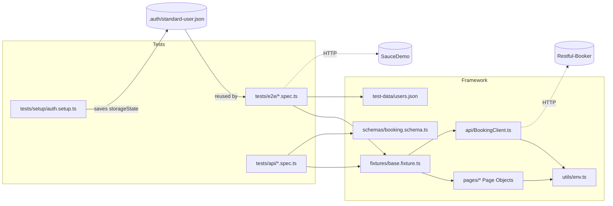
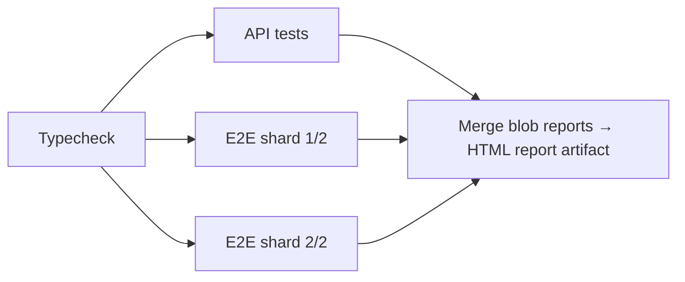

# Playwright + TypeScript Enterprise Test Framework

[](https://github.com/YOUR_GITHUB_USERNAME/playwright-ts-enterprise-framework/actions/workflows/playwright.yml)


A UI and API test automation framework built the way I'd set one up for a real product team: Page Object Model, custom fixtures, login once and reuse the auth state, typed API client with JSON-schema contract checks, and a **sharded CI pipeline** that merges results into one report.

| Layer | Target app | What's covered |
|---|---|---|
| **UI (E2E)** | [SauceDemo](https://www.saucedemo.com) | Login (positive and negative), product sorting, cart state, full checkout, price maths |
| **API** | [Restful-Booker](https://restful-booker.herokuapp.com/apidoc/index.html) | Token auth, full CRUD, partial update, authorization (403), JSON schema validation |

**32 test executions per run:** 12 UI scenarios × 2 browsers (Chromium, Firefox), 7 API tests, and 1 auth setup.

---

## Architecture



### CI pipeline



---

## Design decisions

| Decision | Why |
|---|---|
| **Custom fixtures** (`fixtures/base.fixture.ts`) inject ready-made page objects and an API client | Specs contain only intent and assertions; no `new LoginPage(page)` boilerplate in every test |
| **`setup` project + `storageState`** | Logs in once per run instead of once per test, which cuts run time and removes a common source of flakiness. Login tests opt out with an empty state |
| **`data-test` locators** via `testIdAttribute` | Stable hooks that survive CSS and copy changes, unlike XPath or class selectors |
| **Self-contained API tests** with unique data from `buildBooking()` | No test depends on another's data, so tests can run in any order, in parallel, or split across shards |
| **Ajv JSON schema** with `additionalProperties: false` | Catches contract drift (renamed or extra fields), not only status codes |
| **Sharding + blob report merge** in CI | Splits the browser suite across parallel machines to cut pipeline time, while still publishing one combined report |
| **`trace: 'on-first-retry'`**, screenshot and video on failure | Full debugging evidence for failures without slowing down passing runs |
| **Typed `utils/env.ts`** | One place for config; every value can be overridden per environment from the shell or CI |

---

## Project structure

```
playwright-ts-enterprise-framework/
├── .github/workflows/playwright.yml  # typecheck → API + sharded E2E → merged report
├── api/BookingClient.ts              # typed Restful-Booker client + test data builder
├── fixtures/base.fixture.ts          # page-object & API fixtures
├── pages/                            # BasePage, LoginPage, InventoryPage, CartPage, CheckoutPage
├── schemas/booking.schema.ts         # Ajv JSON schemas
├── test-data/users.json
├── tests/
│   ├── setup/auth.setup.ts           # login once, save storageState
│   ├── e2e/                          # login, inventory, checkout specs
│   └── api/booking.spec.ts           # auth, CRUD, schema, authorization
├── utils/env.ts                      # typed environment config
└── playwright.config.ts              # projects, retries, tracing, reporters
```

---

## Quick start

```bash
git clone https://github.com/YOUR_GITHUB_USERNAME/playwright-ts-enterprise-framework.git
cd playwright-ts-enterprise-framework
npm install && npx playwright install --with-deps chromium firefox
npm test
```

| Command | What it does |
|---|---|
| `npm test` | Full suite: setup + Chromium + Firefox + API |
| `npm run test:e2e` | Browser tests only |
| `npm run test:api` | API tests only, no browser needed |
| `npx playwright test --grep @smoke` | Smoke subset |
| `npm run test:headed` / `npm run test:debug` | Watch or step through in Chromium |
| `npm run report` | Open the HTML report |
| `npm run allure:report` | Build and open the Allure report |
| `npm run typecheck` | Strict TypeScript check |

Point the suite at another environment without code changes:

```bash
BASE_URL=https://staging.example.com API_BASE_URL=https://api.staging.example.com npm test
```

---

## Debugging a failure

1. In CI, download the **`playwright-html-report`** artifact from the workflow run and open `index.html`.
2. Failed tests that were retried include a **trace**: click it to step through every action, network call, and DOM snapshot.
3. Locally: `npx playwright show-trace test-results/<test>/trace.zip`.

---

## Author

**Avinash Kumar Verma**: Senior Test Engineer · ISTQB certified · 9 years in QA, now focused on Playwright, Java/Selenium and API test automation.
