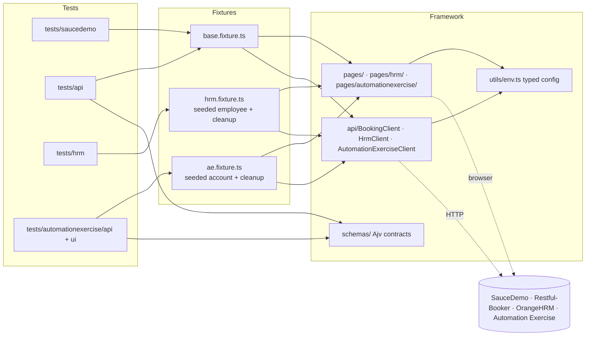
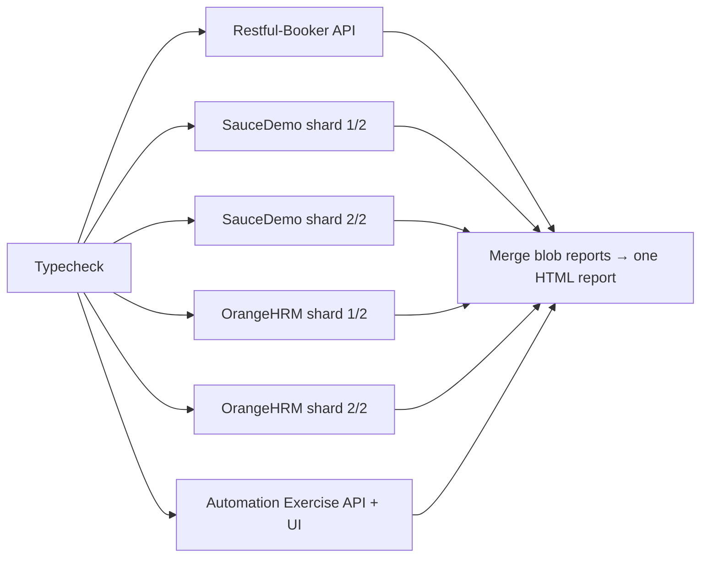

# Playwright + TypeScript Enterprise Test Framework

[](https://github.com/HiAvi-tester/playwright-ts-enterprise-framework/actions/workflows/playwright.yml)


[](https://www.linkedin.com/in/iamavinashkumarverma)

A UI and API test automation framework built the way I'd set one up for a real product team: Page Object Model, custom fixtures, login once and reuse the auth state, typed API clients with JSON-schema contract checks, API-seeded UI tests with guaranteed cleanup, and a **sharded CI pipeline** that merges every job into one report.

It is deliberately **not tied to one site**: the same patterns drive four different public applications, each in its own Playwright project.

---

## Targets

| Target | What it is | Projects | What's tested | Tests |
|---|---|---|---|---|
| [**SauceDemo**](https://www.saucedemo.com) | Demo e-commerce UI | `setup` → `chromium`, `firefox` | Login (positive and negative), product sorting, cart state, full checkout, price maths | 14 scenarios × 2 browsers + setup |
| [**Restful-Booker**](https://restful-booker.herokuapp.com/apidoc/index.html) | Hotel booking REST API | `api` | Token auth, full CRUD, partial update, authorization (403), JSON schema validation | 7 |
| [**OrangeHRM**](https://opensource-demo.orangehrmlive.com) | Open-source HR system (shared public demo, resets daily) | `hrm-setup` → `hrm-chromium` | Login (valid, invalid, empty fields); PIM add / search / edit / delete employee; Admin user search and required-field validation; read-only Dashboard and Leave checks | 11 + setup |
| [**Automation Exercise**](https://automationexercise.com) | E-commerce UI with a public REST API | `ae-api`, `ae-ui` | Account create / verify / detail / update / delete, product list and search, contract checks; UI login, add to cart, cart contents, server-side cart persistence, negative login | 10 API + 4 UI |

**62 test executions per full run** (18 tagged `@smoke`).

### How each target is handled

- **OrangeHRM is a shared demo that anyone can change**, so every test owns its data. Employees get a UUID-based name and Employee Id, are created through OrangeHRM's own REST API (`api/HrmClient.ts`) or the UI, and are deleted in fixture teardown, which runs even when a test fails. No test depends on records that already exist. Fields are located by their visible label, because many OrangeHRM inputs have no stable attributes.
- **Automation Exercise always returns HTTP 200** and puts the real status in a `responseCode` body field (201 created, 400 bad request, 404 not found, 405 wrong method). `api/AutomationExerciseClient.ts` wraps every call in a typed `ApiResult`, and tests assert `responseCode`, so negative tests cannot pass by accident. UI tests create a fresh user through the API, exercise login and cart in the browser, and delete the user through the API afterwards.
- **Public demo sites go down or rate-limit.** CI runs a preflight per site and fails that job alone with an explicit "site unavailable" error. When Automation Exercise serves its 503 "heavy load (queue full)" page during a test, the failure is annotated `site-issue` in the report instead of looking like a test defect.
- **Automation Exercise blocks CI runners.** From GitHub-hosted runners the site answers its API with an HTML bot-protection page instead of JSON, so its CI job is **non-blocking**: it still runs on every push, and when the site blocks the runner it stops at the preflight and posts a ⚠ warning plus a job-summary note saying the tests did not run, without turning the build red. The 14 Automation Exercise tests are verified locally with `npm run test:ae`. The suite does not try to get around the site's bot protection.

---

## Architecture



Setup projects (`setup`, `hrm-setup`) log in once and save `storageState` to `.auth/`, so UI tests start authenticated instead of repeating the login flow.

### CI pipeline



Each test job starts with `.github/scripts/check-site.sh`. The Automation Exercise job is non-blocking (see above). No secrets are required: every target uses the public defaults in `utils/env.ts`.

---

## Design decisions

| Decision | Why |
|---|---|
| **Custom fixtures** inject ready-made page objects and API clients | Specs contain only intent and assertions, with no setup boilerplate in every test |
| **Setup projects + `storageState`** | Log in once per run instead of once per test, which cuts run time and removes a common source of flakiness. Login tests opt out with an empty state |
| **Data seeded through APIs, behaviour tested through the UI** | Fast and reliable setup; the UI test covers only what it is about |
| **Unique data and fixture teardown cleanup** | Tests are independent, so they run in any order, in parallel, or across shards, and leave shared demos clean |
| **`ApiResult` wrapper** for APIs that misuse HTTP status | Assertions use the status the API actually means |
| **Ajv JSON schema** with `additionalProperties: false` | Catches contract drift (renamed or extra fields), not only status codes |
| **Web-first assertions, no sleeps** | Waits follow the app's real signals (URL, network response, `load` event), never fixed timeouts |
| **Sharding + blob report merge** in CI | Splits browser suites across machines to cut pipeline time while still publishing one combined report |
| **`trace: 'on-first-retry'`**, screenshot and video on failure | Full debugging evidence for failures without slowing passing runs |
| **Typed `utils/env.ts`** | One place for config; every value can be overridden per environment |

---

## Project structure

```
playwright-ts-enterprise-framework/
├── .github/
│   ├── workflows/playwright.yml      # typecheck → 4 target jobs (2 sharded) → merged report
│   └── scripts/check-site.sh         # per-site preflight with a clear outage message
├── api/                              # BookingClient, HrmClient, AutomationExerciseClient (+ ApiResult)
├── fixtures/                         # base, hrm and ae fixtures (page objects, seeded data, cleanup)
├── pages/                            # SauceDemo page objects
│   ├── hrm/                          # OrangeHRM: login, dashboard, PIM, admin users, leave
│   └── automationexercise/           # Automation Exercise: login, products, cart
├── schemas/                          # Ajv contracts (bookings, products, user detail)
├── test-data/users.json
├── tests/
│   ├── setup/auth.setup.ts           # SauceDemo login once, save storageState
│   ├── saucedemo/                    # login, inventory, cart, checkout
│   ├── api/booking.spec.ts           # Restful-Booker
│   ├── hrm/                          # hrm.setup.ts, login, pim, admin, dashboard
│   └── automationexercise/{api,ui}/  # accounts, products; login, cart
├── utils/                            # env.ts (typed config), unique.ts (UUID test data)
└── playwright.config.ts              # one group of projects per target
```

---

## Quick start

```bash
git clone https://github.com/HiAvi-tester/playwright-ts-enterprise-framework.git
cd playwright-ts-enterprise-framework
npm ci && npx playwright install --with-deps chromium firefox
npm test
```

Requires Node.js 20+. The Allure report (`npm run allure:report`) also needs Java 8+ on your PATH, because `allure-commandline` is a Java tool.

| Command | What it does |
|---|---|
| `npm test` | Every target and project |
| `npm run test:e2e` | SauceDemo on Chromium + Firefox |
| `npm run test:api` | Restful-Booker API (no browser) |
| `npm run test:hrm` / `npx playwright test --project=hrm-chromium` | OrangeHRM |
| `npm run test:ae` / `npx playwright test --project=ae-api --project=ae-ui` | Automation Exercise API + UI |
| `npm run test:smoke` | `@smoke` subset across all targets |
| `npm run test:headed` / `npm run test:debug` | Watch or step through SauceDemo in Chromium |
| `npm run report` | Open the HTML report |
| `npm run allure:report` | Build and open the Allure report |
| `npm run typecheck` | Strict TypeScript check |

### Configuration

All settings have public-demo defaults in `utils/env.ts`; override any of them per environment (see `.env.example`):

| Variable | Default |
|---|---|
| `WEB_BASE_URL`, `SAUCE_USERNAME`, `SAUCE_PASSWORD` | SauceDemo, `standard_user` / `secret_sauce` |
| `API_BASE_URL`, `BOOKER_USERNAME`, `BOOKER_PASSWORD` | Restful-Booker, `admin` / `password123` |
| `HRM_BASE_URL`, `HRM_USERNAME`, `HRM_PASSWORD` | OrangeHRM demo, `Admin` / `admin123` (published on its login page) |
| `AE_BASE_URL` | `https://automationexercise.com` |
| `WORKERS`, `RETRIES` | CI: 2 workers, 2 retries |

```bash
HRM_BASE_URL=https://hrm.staging.example.com npx playwright test --project=hrm-chromium
```

---

## Debugging a failure

1. In CI, download the **`playwright-html-report`** artifact from the workflow run and open `index.html`.
2. Failed tests that were retried include a **trace**: click it to step through every action, network call, and DOM snapshot.
3. A `site-issue` annotation means the public demo itself was overloaded (HTTP 503), not that the test is wrong.
4. Locally: `npx playwright show-trace test-results/<test>/trace.zip`.

---

## Author

**Avinash Kumar Verma**: Senior Test Engineer · ISTQB certified · 9 years in QA, now focused on Playwright, Java/Selenium and API test automation.

[](https://www.linkedin.com/in/iamavinashkumarverma)

---

## Origin

The page-object base class, typed `utils/env.ts` and `tsconfig.json` come from the author's earlier Playwright practice project; this repo extends them with the API suites, contract checks, auth fixtures, multi-site coverage and sharded CI.
